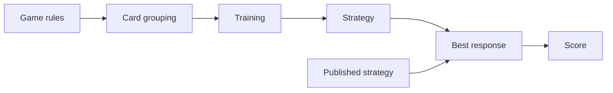

# Rhode Island Hold'em solver

A C++20 program that learns a strategy for Rhode Island Hold'em, a two-player
poker game used in research, and scores it against the strategy Gilpin and
Sandholm published ([J. ACM 2007](https://doi.org/10.1145/1284320.1284324)).

## Results

Chips a perfect opponent wins per hand (exploitability; lower is better, 0 is
perfect):

| Strategy | Exploitability |
|---|---|
| Gilpin and Sandholm | 0.805 |
| This project | 0.094 ± 0.001 |

Ours: 5 seeds, 409.6M iterations, 332 ± 20 s of training on a 16-thread
laptop. Training scales 10× from 1 to 16 threads (`make bench`).

The game matches the paper's exact sizes: 6,632,705 deal nodes, 91,224,226 LP
rows, 1,237,238 after GameShrink.

## Method



- **Card grouping** merges hands that play identically. The authors' GameShrink
  grouping is rebuilt exactly, but in the full game it merges some hands that
  differ, so training uses a finer one (13 / 325 / 7,969 groups).
- **Training** is Monte Carlo CFR: self-play that shifts toward actions it
  regrets not taking, on lock-free shared tables.
- **Best response** finds the strongest counter-strategy exactly, in one pass.

Tests check against fixed answers: the paper's sizes, Kuhn poker's value
(−1/18), and independent reference code. Clean under ASan with UBSan
(`make asan`) and TSan (`make tsan`). CI runs `make test` with Clang on macOS
and GCC on Ubuntu.

## Build

Needs CMake 3.20+, a C++20 compiler, curl and unzip. Catch2 is fetched when
CMake configures.

```sh
make test       # build, fetch the published strategy, run tests
make bench      # speed
make headline   # results table, ~30 min
.build/release/cfr_measure --train 1600000 run.bin run.log 1 16
.build/release/cfr_measure run.bin
.build/release/cfr_play run.bin   # play against it; no argument plays the published strategy
```

MIT license.
