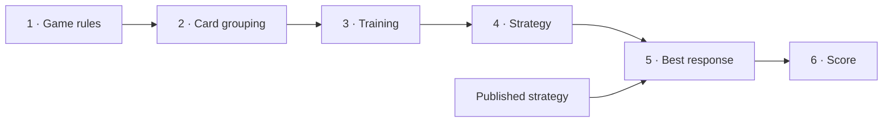

# Rhode Island Hold'em solver

Rhode Island Hold'em is a two-player poker game built as a research test bed
(Shi and Littman, 2002): one private card each, two shared cards, three betting
rounds, and a game tree of over 3.1 billion nodes. Gilpin and Sandholm solved it
with an abstraction method called GameShrink and released their strategy
([J. ACM 2007](https://doi.org/10.1145/1284320.1284324)).

This is a C++20 program that learns its own strategy for the game from scratch,
then scores it and the published one the same way: by computing exactly how many
chips a perfect opponent would win per hand against each.

## Results

| Strategy | Chips lost per hand to a perfect opponent |
|---|---|
| Gilpin and Sandholm, released with the paper | 0.805 |
| This project | 0.094 ± 0.001 |

Lower is better and 0 is a perfect (equilibrium) strategy; the number is called
exploitability. Hands start with a 5-chip ante and bets of 10 or 20. Ours is the
mean ± standard deviation over 5 seeds after 409.6 million training iterations,
which take 332 ± 20 s on a 2019 MacBook Pro (8-core i9, 16 threads).

The game model matches the three exact sizes the paper reports, each one a test:

| Size in the paper | Paper | This code |
|---|---|---|
| Card-dealing tree, nodes | 6,632,705 | 6,632,705 |
| Linear program for the full game, rows | 91,224,226 | 91,224,226 |
| Linear program after GameShrink, rows | 1,237,238 | 1,237,238 |

Speed (`make bench`): 1.6 million iterations take 10.68 ± 0.07 s on one thread;
6.4 million take 44.0 s on one thread and 4.4 s on 16, 10× faster.

## Method



1. **Game rules** (`src/game`, `src/eval`): deals, betting, and who wins, with
   hands ranked by a table of all 22,100 three-card hands.
2. **Card grouping** (`src/abstraction`): hands that play the same way, such as
   the same rank in another suit, share one strategy. This rebuilds the
   authors' GameShrink grouping exactly. In the full game that grouping merges
   some hands that play differently once the opponent's cards are counted, so a
   strategy exact for the grouped game is not exact for the real one. Training
   uses a finer grouping that merges only equivalent hands: 13, 325 and 7,969
   groups across the three rounds.
3. **Training** (`src/solver/mccfr_solver.hpp`): Monte Carlo counterfactual
   regret minimization. The program plays sampled hands against itself and
   shifts probability toward the actions it regrets not taking. Threads share
   one table through lock-free atomic adds; one thread is byte-identical run to
   run.
4. **Strategy**: the average of what training played, saved as a checkpoint.
5. **Best response** (`src/solver/rih_best_response.cpp`): the strongest
   possible counter-strategy, found in one pass over the game tree that tracks
   every opponent card at once. `src/grader` reads the published strategy into
   the same step.
6. **Score**: the average of both seats' best-response winnings.

## Testing

Tests compare against answers the code cannot move: the paper's sizes, Kuhn
poker's known value of −1/18, sampled training on Leduc poker scored by an exact
best response (both tiny games live in `tests/oracles`), an independent hand
evaluator over every three-card
hand, and the published strategy's score. Each key test was checked by planting
a matching bug and seeing it fail. The suite is clean under AddressSanitizer,
UndefinedBehaviorSanitizer and ThreadSanitizer, and CI builds it with Clang on
macOS and GCC on Ubuntu.

## Build and run

Needs a C++20 compiler, CMake 3.20+, curl and unzip.

```sh
make test       # build, fetch the published strategy (checksum-checked), run tests
make bench      # the speed numbers above
make headline   # the results table, about 30 minutes

.build/release/cfr_measure --train 1600000 run.bin run.log 1 16  # iterations, files, seed, threads
.build/release/cfr_measure run.bin                               # score a checkpoint
.build/release/cfr_measure --published                           # score the published strategy
```

MIT license.
